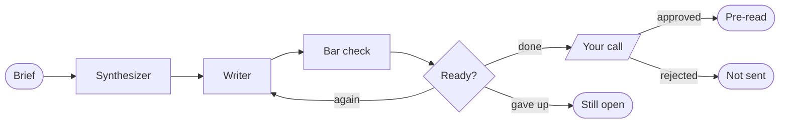
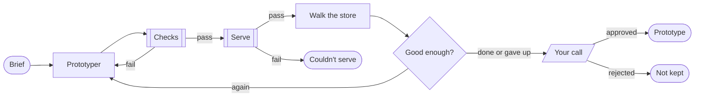
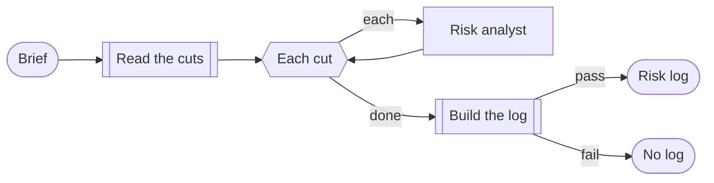

# Queen Bee demos: an agent handoff, from findings to receipts

Three small, working examples of people and agents doing real work together in [Queen Bee](https://github.com/bamboozledkitty/queen-bee), a Mac app for building and running flows of Claude Code agents on a canvas.

They share one story. An AI service agent hands a conversation to a human rep, and the handoff isn't working. All the material in `inputs/` is fictitious.

| Flow | What goes in | What comes out |
| --- | --- | --- |
| **1. Findings to Decisions** | Six interviews and a telemetry snapshot | A pre-read in the "Decisions for Today" format: `output/pre-read.md` |
| **2. Make It Real** | Decision 1 from that pre-read and one handed-off conversation | A working prototype you can click through: `prototype/index.html` |
| **3. Keep the Receipts** | Seven things cut from the release | An experience risk log spreadsheet: `output/experience-risk-log.csv` |

Run them in order for the whole story, or each on its own. Make It Real works without a pre-read: it builds from the interviews instead.

## 1. Findings to Decisions



| Card | What it does |
| --- | --- |
| **Brief** | The ask the run starts with. |
| **Synthesizer** (agent, Sonnet) | Reads `inputs/`, writes `work/findings.md`: the findings that matter, the evidence behind each, where the evidence is thin, and the real forks they force. |
| **Writer** (agent, Sonnet) | Drafts `work/pre-read.md` in the Decisions for Today format, then revises it on feedback. |
| **Bar check** (agent, Opus) | Reviews the draft against the criteria in the wwrkd skill (`.claude/skills/wwrkd`) and against the evidence. Replies `VERDICT: READY` with the pre-read, or `VERDICT: NOT YET` with the one or two changes that would matter most. |
| **Ready?** (Loop until) | Sends the draft back to the Writer until the Bar check says ready, three tries at most. |
| **Your call** (Approval) | The run stops here for a person. Edit the pre-read if you like, then approve or reject. |
| **Pre-read** / **Not sent** / **Still open** (End) | Where the run finishes. Approved goes to `output/pre-read.md`. If three rounds weren't enough, the last feedback goes to `output/bar-check-notes.md`. |

Capped at $15. Takes about 5 to 10 minutes.

## 2. Make It Real

The pre-read's first decision, built instead of described. The output is a page you can use, and an agent uses it in front of you before you do.



| Card | What it does |
| --- | --- |
| **Prototyper** (agent, Sonnet) | Writes `prototype/index.html`, one file with nothing loaded from the internet: the view a rep sees when the agent in `inputs/conversation.md` hands over. It separates what the agent verified from what it couldn't, lists what the agent promised, and shows how the customer is doing in their own words. Fixes whatever comes back to it. |
| **Checks** (script) | `tools/check_prototype.py`: plain tests anyone can read, such as a main landmark, labelled buttons, visible focus, nothing external and no placeholder text. A failure goes back to the Prototyper with the list, twice at most. |
| **Serve** (script) | `tools/serve.py` serves the prototype at `http://127.0.0.1:8765/`, on this Mac only. The server stops by itself after 45 minutes. |
| **Walk the store** (agent with a browser, Sonnet) | Uses the page in its card as the rep would: reads it, opens the transcript, takes over by button and again by keyboard alone. Replies `WALKTHROUGH: PASS` or `WALKTHROUGH: FIX` with the one or two problems that would hurt a rep most. It doesn't edit files. |
| **Good enough?** (Loop until) | Sends fixes back to the Prototyper until the walkthrough passes, two tries at most. Either way, you get the last word. |
| **Your call** (Approval) | Try the page yourself in the Walk the store card. Approve to keep the walkthrough notes in `output/prototype-walkthrough.md`. |

Capped at $10. Takes about 5 to 10 minutes. The browser agent's clicks, typing and key presses are allowed in `.claude/settings.json`, so it doesn't stop to ask for each one.

## 3. Keep the Receipts

When something is cut to ship, the cost to the customer usually goes unwritten. This flow writes it down: for each cut, what was meant to ship, what did, why, the quality given up, what a rep or customer will feel, how bad it is, and the question its owner should answer.



| Card | What it does |
| --- | --- |
| **Read the cuts** (script) | Reads `inputs/descoped.txt`, one cut per line. |
| **Each cut** (For each) | Hands the cuts to the Risk analyst one at a time and gathers the answers. |
| **Risk analyst** (agent, Sonnet) | Answers each cut with one JSON record, judged against the dimensions of craft in the wwrkd skill and backed by a participant or telemetry line from `inputs/`, or marked "None in inputs". It never invents evidence. |
| **Build the log** (script) | `tools/risk_log.py` writes the records to `output/experience-risk-log.csv`, highest severity first, and prints a summary with the questions for the owners of the high-severity cuts. |
| **Risk log** (End) | Saves that summary to `output/experience-risk-log.md`. |

Capped at $10. Takes about 3 to 5 minutes. Open the CSV in Numbers or Excel.

## Run them

You need macOS 26 or later on Apple silicon, [Queen Bee](https://github.com/bamboozledkitty/queen-bee#install), [Claude Code](https://claude.com/claude-code), signed in, and `python3` (the one that comes with the Xcode command line tools is enough).

1. Copy in the wwrkd skill (see below), then in Queen Bee choose **Add Project Folder…** at the foot of the sidebar and pick this folder, `demos/agent-handoff`. Queen Bee asks whether you trust the flows in it, because they start agents. Choose **Trust and Open**.
2. Open a flow and press **Run**.
3. Watch each agent work in its card. Click into any terminal to read it or type to it.
4. The first time a run reaches a script card, Queen Bee shows you its command and asks you to allow it. Read it and allow it. Queen Bee remembers that for the card.
5. When an approval card lights up, click its title to read what it holds, edit it if you want, and approve.

Spending caps are under the sliders button in the toolbar.

## Run them again

Delete what's in `work/`, `output/` and `prototype/` first, so the agents start fresh. Each agent card keeps its Claude Code session between runs; **Restart** in a card's settings starts it clean.

## About the wwrkd skill

The wwrkd skill isn't in this repo. It quotes internal material, so it lives in its own private repo. Before the first run, copy it into this folder (git ignores it here, so it can't be committed by accident):

```sh
gh repo clone aweibel_sfemu/wwrkd ~/git/wwrkd
mkdir -p .claude/skills && cp -R ~/git/wwrkd/skills/wwrkd .claude/skills/
```

Without it, the Bar check and the Risk analyst have no criteria to read.

The Bar check and the Risk analyst use a copy of the wwrkd skill (taken 2026-09-21), a model of one leader's stated standards built only from her own published words. It is a rehearsal tool for your own preparation, not her judgment.
